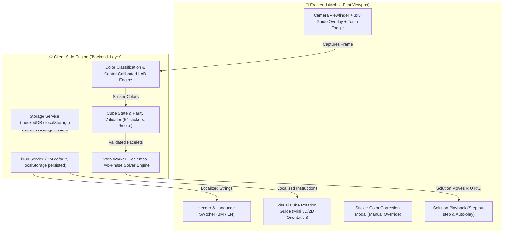

GNOME_KEYRING_CONTROL=/run/user/1000/keyring

[bold cyan]⚡ [AUTO-APPROVED] Tool (run_command):[/] [dim]ls -la[/]
[bold green]✔ Finished run_command[/]

[bold cyan]⚡ [AUTO-APPROVED] Tool (view_file):[/] [dim][/]
[bold green]✔ Finished view_file[/]

[bold cyan]⚡ [AUTO-APPROVED] Tool (view_file):[/] [dim][/]
[bold green]✔ Finished view_file[/]

[bold cyan]⚡ [AUTO-APPROVED] Tool (view_file):[/] [dim][/]
[bold green]✔ Finished view_file[/]

[bold cyan]⚡ [AUTO-APPROVED] Tool (view_file):[/] [dim][/]
[bold green]✔ Finished view_file[/]

[bold cyan]⚡ [AUTO-APPROVED] Tool (view_file):[/] [dim][/]
[bold green]✔ Finished view_file[/]
# 🏛️ Architecture & Technical Specification: Mobile-First 3x3 Cube Solver

**Project:** 3x3 Rubik's Cube Solver (Web / Serverless)  
**Deployment Target:** GitHub Pages (100% Client-Side Static Architecture)  
**Default Language:** Bahasa Melayu (BM) 🇲🇾 | Secondary: English (EN) 🇬🇧  
**Lead Roles:** System Architect & Product Manager  

---

## 1. Project Synthesis & System Architecture

### 1.1 Problem Statement & User Experience (UX) Bottlenecks
The existing implementation requires users to juggle holding a 3x3 cube while snapping 6 faces on a desktop-oriented layout. In real-world mobile usage:
1. **Camera & Physical Handling:** Users hold the cube in one hand and the phone in the other. If the snap instructions are ambiguous (e.g., how to rotate the cube between faces), the orientation sequence fails and the solver crashes with invalid parity.
2. **Lighting Variations:** Fixed RGB distance matching fails under warm indoor lighting (white looks yellow, red looks orange).
3. **Language Accessibility:** Many local users prefer straightforward Bahasa Melayu guidance (e.g., *"Pusing kiub ke kanan untuk imbas muka Merah"*).
4. **Serverless Constraint:** GitHub Pages does not support dynamic backend servers (Node.js/Python/Docker). All compute (vision, validation, Kociemba two-phase algorithm) must execute **client-side** without freezing the mobile UI thread.

### 1.2 Architectural Solution


---

## 2. Technical Specification & Data Contracts

Since the application runs on **GitHub Pages**, the *"Backend"* is designed as an isolated, headless **Client-Side Core Engine & Worker Service** that decouples business logic from DOM presentation.

### 2.1 Core Data Models (`types.d.ts`)

```typescript
// Singmaster Face Notations
export type FaceId = 'U' | 'R' | 'F' | 'D' | 'L' | 'B';

// Standard 6 Cube Colors
export type CubeColor = 'white' | 'red' | 'green' | 'yellow' | 'orange' | 'blue';

// Single face representation (3x3 = 9 stickers, index 4 is fixed center)
export interface FaceData {
  face: FaceId;
  centerColor: CubeColor;
  stickers: CubeColor[]; // Length 9
  capturedImageUri?: string; // DataURL preview
}

// Full 54-facelet representation (URFDLB sequence)
export interface CubeState {
  U: CubeColor[]; // [0..8]
  R: CubeColor[];
  F: CubeColor[];
  D: CubeColor[];
  L: CubeColor[];
  B: CubeColor[];
}

// Visual Step Guide for Snapping
export interface SnapStepGuide {
  face: FaceId;
  expectedCenter: CubeColor;
  titleMs: string;
  titleEn: string;
  instructionMs: string;
  instructionEn: string;
  rotationHint: 'START' | 'ROTATE_RIGHT' | 'ROTATE_DOWN' | 'ROTATE_UP';
}

// Solver Response Contract
export interface SolverResponse {
  success: boolean;
  moves: string[]; // e.g. ["R", "U'", "F2", "D"]
  moveCount: number;
  executionTimeMs: number;
  errorMessage?: string;
  errorDetail?: {
    code: 'INVALID_COLORS' | 'UNBALANCED_COUNT' | 'PARITY_ERROR' | 'SOLVER_TIMEOUT';
    messageMs: string;
    messageEn: string;
  };
}
```

### 2.2 In-Browser Service Contracts & API Interfaces

#### A. Vision & Color Engine (`ColorDetectionEngine`)
```typescript
interface ColorDetectionEngine {
  /**
   * Samples 9 sticker regions from the video canvas.
   * Uses CIELAB delta-E distance calibrated against the 6 detected centers.
   */
  sampleFace(
    videoEl: HTMLVideoElement,
    viewfinderRect: { x: number; y: number; size: number }
  ): Promise<CubeColor[]>;

  /**
   * Recalibrates color reference profiles based on user's lighting
   */
  calibrateCenters(centers: Record<FaceId, [number, number, number]>): void;
}
```

#### B. Cube Solver Web Worker Contract (`cube-worker.js`)
To prevent frame drops on mobile devices during heavy Kociemba search:
- **Request Message:**
  ```json
  {
    "type": "SOLVE_CUBE",
    "payload": {
      "cubeString": "UUUUUUUUURRRRRRRRRFFFFFFFFFDDDDDDDDDLLLLLLLLLBBBBBBBBB",
      "maxSolutions": 1,
      "maxDepth": 22
    }
  }
  ```
- **Response Message:**
  ```json
  {
    "type": "SOLVE_SUCCESS",
    "payload": {
      "moves": ["U", "R2", "F'", "D", "L2", "B"],
      "moveCount": 6,
      "timeTakenMs": 142
    }
  }
  ```

#### C. Local Storage Schema
| Key | Type | Description | Default |
| :--- | :--- | :--- | :--- |
| `cube_solver_lang` | `'ms' \| 'en'` | User language preference | `'ms'` |
| `cube_solver_speed` | `number` | Playback speed in ms | `600` |
| `cube_solver_flash` | `boolean` | Torch state memory | `false` |
| `cube_solver_draft` | `CubeState \| null` | Auto-save scanned faces if page refreshes | `null` |

---

## 3. Implementation Decomposition

### `[BACKEND_TASK]` — Client-Side Engine, Worker & Business Logic

1. **Storage & State Persistence Layer (`src/engine/storage.js`)**:
   - Implement storage manager wrapping `localStorage` with fail-safe fallback in private browsing mode.
   - Schema enforcement for language preferences and cube scan drafts.

2. **Adaptive Color Classifier Engine (`src/engine/color-engine.js`)**:
   - Convert raw RGB frame pixels into CIELAB color space ($L^*, a^*, b^*$).
   - Implement Dynamic Center Calibration: Use the center sticker of each scanned face (indices 4 of U, R, F, D, L, B) as dynamic reference centroids, vastly outperforming fixed RGB heuristics under warm or cool room lighting.
   - Fallback to nearest color with Euclidean delta-E.

3. **Cube State Validator (`src/engine/validator.js`)**:
   - Verify all 54 stickers are assigned.
   - Ensure exact distribution count: exactly 9 stickers of each of the 6 colors.
   - Check center stickers invariant (`U=White`, `R=Red`, `F=Green`, `D=Yellow`, `L=Orange`, `B=Blue`).
   - Validate corner and edge orientation parity before feeding to the solver to prevent solver freezes.

4. **Kociemba Solver Web Worker (`src/engine/solver-worker.js`)**:
   - Wrap the Two-Phase Kociemba algorithm inside a standalone Web Worker (`cube-worker.js`).
   - Implement timeout guards (maximum 5000ms search limit).
   - Normalize output moves (combining duplicate moves like `R R` -> `R2`).

5. **Engine Automated Test Suite (`tests/engine.test.js`)**:
   - **Test 1: Parity & Color Count Validator:** Verify failure when yellow has 10 stickers and white has 8.
   - **Test 2: Color Distance Classifier:** Test discrimination between orange (`rgb(255, 120, 0)`) and red (`rgb(220, 20, 20)`) under simulated warm lighting.
   - **Test 3: Web Worker Solver:** Feed known scrambles (e.g. `Superflip` or standard 20-move scrambles) and assert valid solutions that return the cube to solved state.

---

### `[FRONTEND_TASK]` — Mobile UX, Guides, i18n & Solution Player

1. **Mobile-First Responsive Layout & Styling (`style.css`)**:
   - CSS variables design tokens supporting dark/light camera backdrop.
   - Viewport height lock (`100dvh`) with `safe-area-inset` support for iOS notch and Android gesture bars.
   - Single-column thumb-friendly layout: Viewfinder at the top/center, floating action controls at the bottom.

2. **Bilingual Localization System (`src/i18n.js`)**:
   - Default language: **Bahasa Melayu (`ms`)**.
   - Language toggle selector (🇲🇾 BM / 🇬🇧 EN) in the header.
   - Complete localized dictionary covering:
     - Titles, buttons (*"Tangkap Gambar"*, *"Imbas Semula"*, *"Selesaikan"*).
     - Face instructions (*"Muka Atas (Putih)"*, *"Muka Hadapan (Hijau)"*, etc.).
     - Rotation guide instructions (*"Pusing kiub 90° ke kanan..."*).
     - Error messages (*"Warna kiub tidak seimbang: Pastikan setiap warna ada 9 kotak"*).

3. **Interactive Camera Viewfinder & Step-by-Step Snap Guide**:
   - Direct camera stream with back-camera default (`facingMode: { ideal: "environment" }`).
   - Torch/Flash button (using `MediaTrackConstraints.advanced = [{ torch: true }]` where supported on mobile Chrome/Android).
   - High-contrast square grid reticle (3x3 grid) with live center color indicator dot.
   - **Visual Cube Rotation Assistant:** A visual miniature diagram showing how to rotate the physical cube to reach the next face:
     - Step 1 (U): Muka Putih di atas, Hijau di hadapan.
     - Step 2 (R): Pusing kiub 90° ke kiri (muka Merah kini di hadapan).
     - Step 3 (F): Pusing kiub kembali ke muka Hijau.
     - Step 4 (D): Condongkan kiub untuk muka Kuning di bawah.
     - Step 5 (L): Pusing ke muka Jingga/Orange.
     - Step 6 (B): Pusing ke muka Biru.

4. **Manual Sticker Color Correction Palette**:
   - Interactive preview of captured faces.
   - If camera misidentifies a sticker due to shadow, user can tap any of the 9 stickers to open a 6-color quick picker to correct it manually before solving.

5. **Solution Step-by-Step Player**:
   - Large touch controls: **Undur (Prev)**, **Main/Jeda (Play/Pause)**, **Maju (Next)**, **Set Semula (Reset)**.
   - Move highlight badge with plain language translation (e.g., `R'` -> *"Pusing kanan lawan jam"* / *"Turn Right counter-clockwise"*).
   - Interactive 2D unfolded cube net displaying current state dynamically updating as moves are stepped.

6. **Repository & Documentation Update (`README.md`)**:
   - Complete overhaul of `README.md`.
   - Bilingual overview (Bahasa Melayu & English).
   - Step-by-step GitHub Pages activation guide.
   - Mobile camera permissions troubleshooting (HTTPS requirement, iOS Safari & Chrome Android permissions).

---

## 4. Key Design Decisions & Clarification Points

Before proceeding with code implementation, please review these architectural choices:

1. **3D Animation vs. Lightweight 2D Interactive Net:**
   - *Option A (Recommended):* Lightweight 2D SVG/Canvas unfolded net (Zero external dependencies, loads in <1s on mobile, battery friendly).
   - *Option B:* Three.js 3D interactive rendered cube (Rich visuals, ~600KB extra bundle size).
2. **Offline Support (PWA):**
   - We can include a lightweight `manifest.json` and Service Worker so the cube solver can be added to the mobile home screen and work offline without internet.

Let me know if you would like to adjust any of these specifications, or approve them to begin the code implementation!
